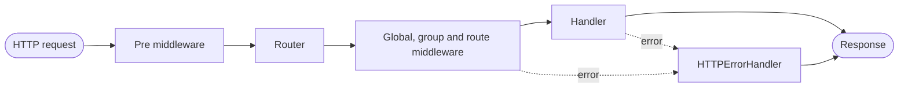

<p align="center">
  <a href="https://echo.labstack.com">
    <picture>
      <source media="(prefers-color-scheme: dark)" srcset=".github/assets/echo-logo-dark.svg">
      
    </picture>
  </a>
</p>

<p align="center"><strong>High performance, extensible, minimalist Go web framework.</strong></p>

<p align="center">
  <a href="https://github.com/labstack/echo/releases"></a>
  <a href="https://github.com/labstack/echo/commits/master"></a>
  <a href="https://pkg.go.dev/github.com/labstack/echo/v5"></a>
  <a href="https://github.com/labstack/echo/actions/workflows/ci.yml"></a>
  <a href="https://codecov.io/gh/labstack/echo"></a>
  <a href="https://scorecard.dev/viewer/?uri=github.com/labstack/echo"></a>
  <a href="https://github.com/sponsors/labstack"></a>
  <a href="https://github.com/labstack/echo/discussions"></a>
  <a href="https://x.com/labstack"></a>
  <a href="https://github.com/labstack/echo/blob/master/LICENSE"></a>
</p>

<p align="center">
  <a href="https://echo.labstack.com">Website</a> ·
  <a href="https://echo.labstack.com/guide/quickstart/">Quick start</a> ·
  <a href="https://echo.labstack.com/middleware/">Middleware</a> ·
  <a href="https://pkg.go.dev/github.com/labstack/echo/v5">API reference</a> ·
  <a href="https://github.com/labstack/echo/discussions">Discussions</a> ·
  <a href="https://echo.labstack.com/pro">Echo Pro</a> ·
  <a href="https://echo.labstack.com/pro#support">Commercial support</a>
</p>

## About

Echo is built on Go's standard `net/http` and interoperates with it through `echo.WrapHandler` and `echo.WrapMiddleware`. It adds the parts the standard library leaves to you: a fast radix-tree router, request binding with pluggable validation, official and third-party middleware, and centralized error handling. Echo is actively maintained, and `v5` is the current release line.

### How a request flows



`e.Pre` middleware runs before routing, so it can rewrite the path or method. Everything registered with `e.Use`, a group or a route runs after the router has matched. Any error returned by middleware or the handler goes to one `HTTPErrorHandler`.

### Features

- Radix-tree [router](https://echo.labstack.com/guide/routing/) with static, parameter and wildcard routes; static routes match first
- Route groups, with middleware at the root, group or route level
- [Data binding](https://echo.labstack.com/guide/binding/) for JSON, XML, form, query and path parameters, with pluggable validation
- Helpers for JSON, XML, HTML, file, stream and other responses
- Centralized [error handling](https://echo.labstack.com/guide/error-handling/)
- Structured request logging with `log/slog`
- [Template rendering](https://echo.labstack.com/guide/templates/) with any template engine
- TLS, [HTTP/2](https://echo.labstack.com/cookbook/http2/), [Let's Encrypt certificates](https://echo.labstack.com/cookbook/auto-tls/) through `autocert`, and [graceful shutdown](https://echo.labstack.com/cookbook/graceful-shutdown/)

## Echo Pro and support

[Echo Pro](https://echo.labstack.com/pro) is a separate commercial library from LabStack for Echo v5: API key and JWT authentication, tenant isolation, quotas with usage metering, audit records, signed webhooks and an admin console. Echo itself stays MIT, and Pro subscriptions fund its maintenance.

[Echo Support](https://echo.labstack.com/pro#support) is a paid annual plan for v4 and v5 applications, with a named contact and email support.

## Used by

Echo runs in production across the Go ecosystem, including:

| Project | What runs on Echo |
| --- | --- |
| [Bluesky indigo](https://github.com/bluesky-social/indigo) | AT Protocol Relay and network services |
| [Temporal UI](https://github.com/temporalio/ui) | Temporal Web UI server |
| [NVIDIA Cloud Functions](https://github.com/NVIDIA/nvcf) | LLM API gateway |
| [Azure Container Networking](https://github.com/Azure/azure-container-networking) | Container Networking Service REST API |
| [osbuild-composer](https://github.com/osbuild/osbuild-composer) | Red Hat Image Builder cloud API |
| [Docker Agent](https://github.com/docker/docker-agent) | Agent API, chat and A2A servers |
| [YugabyteDB](https://github.com/yugabyte/yugabyte-db) | yugabyted UI API server |
| [PostHog](https://github.com/PostHog/posthog) | Livestream service |
| [Bytebase](https://github.com/bytebase/bytebase) | Backend server and API |
| [Hatchet](https://github.com/hatchet-dev/hatchet) | API server |
| [CasaOS](https://github.com/IceWhaleTech/CasaOS) | API server |
| [Hanko](https://github.com/teamhanko/hanko) | Authentication backend |

See [ADOPTERS.md](./ADOPTERS.md) for the full list. Using Echo in an open source project? [Add it](./ADOPTERS.md#add-your-project).

## Sponsors

| | Sponsor |
| --- | --- |
| <a href="https://blacksmith.sh"></a> | [Blacksmith](https://blacksmith.sh): faster, drop-in GitHub Actions runners |
| <a href="https://encore.dev"></a> | [Encore](https://encore.dev): the platform for building Go-based cloud backends |
| <a href="https://github.com/gravitycarbon"></a> | [Gravity Carbon](https://github.com/gravitycarbon) |

Echo is independent and community funded. If your company depends on Echo, please consider [sponsoring it](https://github.com/sponsors/labstack).

## Getting started

### Supported versions

- `v5` is the current major version, released on 2026-01-18. See [API_CHANGES_V5.md](./API_CHANGES_V5.md) for the API changes from `v4` and upgrade notes.
- `v4` receives bug fixes until 2026-12-31 and security fixes until 2027-12-31, on its latest release. See [SECURITY.md](./SECURITY.md).

> [!NOTE]
> Echo v4 is in maintenance and gets no new features. Start new projects on v5, and plan v4 upgrades with [API_CHANGES_V5.md](./API_CHANGES_V5.md).

See [ROADMAP.md](./ROADMAP.md) for where Echo is heading and the version support policy.

### Installation

```sh
go get github.com/labstack/echo/v5
```

Echo v5 supports the three most recent Go [releases](https://go.dev/doc/devel/release) and may work with older ones. Echo v4 requires Go 1.26 or later.

### Example

```go
package main

import (
	"log/slog"
	"net/http"

	"github.com/labstack/echo/v5"
	"github.com/labstack/echo/v5/middleware"
)

func main() {
	e := echo.New()

	e.Use(middleware.RequestLogger()) // log requests with log/slog
	e.Use(middleware.Recover())       // recover from panics and return an error

	e.GET("/", hello)

	if err := e.Start(":8080"); err != nil {
		slog.Error("failed to start server", "error", err)
	}
}

func hello(c *echo.Context) error {
	return c.String(http.StatusOK, "Hello, World!")
}
```

Run it and send a request:

```console
$ go run .
$ curl http://localhost:8080/
Hello, World!
```

`e.Start` shuts the server down gracefully on <kbd>Ctrl</kbd>+<kbd>C</kbd>.

More in the [guide](https://echo.labstack.com/guide/quickstart/) and the [cookbook](https://echo.labstack.com/cookbook/hello-world/).

## Middleware

### Official

Maintained by the Echo team.

| Repository | Description |
| --- | --- |
| [labstack/echo-jwt](https://github.com/labstack/echo-jwt) | [JWT](https://github.com/golang-jwt/jwt) authentication |
| [labstack/echo-contrib](https://github.com/labstack/echo-contrib) | [Casbin](https://github.com/casbin/casbin), [gorilla/sessions](https://github.com/gorilla/sessions) and [pprof](https://pkg.go.dev/net/http/pprof) |
| [labstack/echo-otel](https://github.com/labstack/echo-otel) | [OpenTelemetry](https://opentelemetry.io/) tracing and metrics |
| [labstack/echo-prometheus](https://github.com/labstack/echo-prometheus) | [Prometheus](https://github.com/prometheus/client_golang/) metrics |

### Third-party

<details>
<summary>Third-party middleware list</summary>

These projects are maintained by their authors, not the Echo team. Review them before use, and check which Echo version (`v4` or `v5`) each supports.

| Repository | Description |
| --- | --- |
| [oapi-codegen/oapi-codegen](https://github.com/oapi-codegen/oapi-codegen) | [OpenAPI](https://swagger.io/specification/) client and server code generator |
| [swaggo/echo-swagger](https://github.com/swaggo/echo-swagger) | Serves [Swagger](https://swagger.io/) 2.0 API documentation |
| [ziflex/lecho](https://github.com/ziflex/lecho) | [Zerolog](https://github.com/rs/zerolog) logger for Echo |
| [brpaz/echozap](https://github.com/brpaz/echozap) | Uber [Zap](https://github.com/uber-go/zap) logging middleware |
| [samber/slog-echo](https://github.com/samber/slog-echo) | [log/slog](https://pkg.go.dev/log/slog) logging middleware |
| [darkweak/souin](https://github.com/darkweak/souin/tree/master/plugins/echo) | HTTP cache middleware based on [Souin](https://github.com/darkweak/souin), with distributed storage support |
| [mikestefanello/pagoda](https://github.com/mikestefanello/pagoda) | Full-stack web development starter kit built on Echo |
| [go-woo/protoc-gen-echo](https://github.com/go-woo/protoc-gen-echo) | Generates Echo server code from Protocol Buffers |

</details>

To add your library, send a pull request.

## Contributing

- For a small change, send a pull request.
- For a bigger change, open an issue to discuss it first.
- A pull request should include tests, documentation and, where it helps, an example.

## Security

> [!IMPORTANT]
> Report vulnerabilities privately through [GitHub Security Advisories](https://github.com/labstack/echo/security/advisories/new), not in public issues. See [SECURITY.md](./SECURITY.md) for supported versions.

## Credits

- [Vishal Rana](https://github.com/vishr) (Author and Maintainer)
- [Nitin Rana](https://github.com/nr17) (Consultant)
- [Martti T.](https://github.com/aldas) (Maintainer Emeritus)
- [Roland Lammel](https://github.com/lammel) (Maintainer Emeritus)
- [Pablo Andres Fuente](https://github.com/pafuent) (Maintainer Emeritus)
- [Contributors](https://github.com/labstack/echo/graphs/contributors)

## License

[MIT](./LICENSE)
